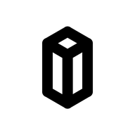
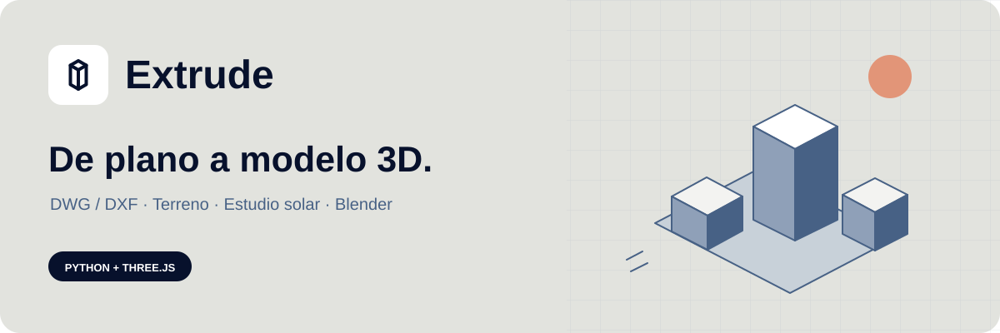

<p align="center">
  
</p>

<h1 align="center">Extrude</h1>

<p align="center"><strong>De plano a modelo 3D.</strong><br />DWG / DXF · Terreno · Estudio solar · Vistas para Blender</p>



Extrude convierte planos urbanos en DWG o DXF (un proyecto, una manzana, un barrio o una ciudad)
en un **modelo 3D que puedes recorrer en el navegador**: con terreno, sol real según la fecha y el
lugar, materiales, vistas guardadas, capturas en HD y 4K e imágenes de presentación generadas con
IA. Todo desde el visor web, sin instalar programas de 3D.

[Empezar](#empezar) · [Cómo se trabaja](#cómo-se-trabaja) · [IA](#imágenes-y-edición-con-ia) ·
[Problemas frecuentes](#problemas-frecuentes) · [Limitaciones](#limitaciones) ·
[Para desarrolladores](#para-desarrolladores-y-administración)

## Qué puedes hacer

- **Convertir tu plano en 3D** arrastrándolo al visor. Extrude lee las capas, deduce alturas
  (atributos, textos como «4P» o «B+3», cotas) y propone una configuración que puedes revisar.
- **Revisar la calidad**: qué alturas son supuestas, qué capas quedan pendientes y qué edificios
  flotan o se entierran, con la opción de corregirlo y reconvertir sin salir del visor.
- **Ajustar el modelo**: altura por capa, tipo de cada capa (edificio, vial, agua, vegetación,
  terreno) y materiales reales con textura por edificio y superficie.
- **Estudiar el sol y las sombras** en cualquier fecha y hora, con la posición real del lugar.
- **Medir** distancias, desniveles y pendientes, con lupa para afinar.
- **Guardar vistas** (cámara, sol, capas y entorno) y sacar **capturas en HD y 4K**.
- **Generar imágenes de presentación con IA** a partir de tus vistas, con frases de ayuda por
  categorías (estilo, edificios completos, gente y vida urbana, luz, clima…) y una leyenda de
  capas para que la IA no confunda, por ejemplo, una calle con un muro.
- **Editar el proyecto con IA** escribiendo lo que quieres: «sube E-001 dos plantas, ladrillo
  claro en todos salvo E-004, una vista al atardecer». Ves la propuesta antes de aplicarla y puedes
  deshacerla.
- **Llevarlo a Blender** o a otros programas: GLB con cámaras y luces, script de Blender y
  `views.json`.

## Empezar

### Si te han dado una dirección web

Ábrela en el navegador e inicia sesión con el usuario que te hayan dado. No necesitas instalar
nada. Dentro del visor, el botón **Guía** explica todo paso a paso.

### En un ordenador con Windows, con icono

Instala [Docker Desktop](https://www.docker.com/products/docker-desktop/), copia la carpeta de
Extrude y haz doble clic en **Instalar Extrude.bat**. Crea un icono **Extrude** en el escritorio
y en el menú Inicio que lo arranca todo y lo abre en su propia ventana, como una aplicación.
Paso a paso: [docs/INSTALAR_WINDOWS.md](docs/INSTALAR_WINDOWS.md).

### En tu ordenador, con Docker (cualquier sistema)

1. Instala y abre [Docker Desktop](https://www.docker.com/products/docker-desktop/).
2. En la carpeta de Extrude, ejecuta:

   ```sh
   docker compose up -d --build
   ```

3. Abre **[localhost:8080](http://localhost:8080)**.

La primera vez tarda unos minutos en prepararse; las siguientes arranca en segundos. Solo es
accesible desde tu ordenador y no pide usuario. Acepta planos **DWG** y **DXF** y modelos
GLB/GLTF.

| Para… | Ejecuta |
|---|---|
| Parar Extrude (conserva tus proyectos) | `docker compose down` |
| Volver a arrancarlo, o actualizarlo tras descargar una versión nueva | `docker compose up -d --build` |
| Ver si está funcionando | `docker compose ps` |

Tus proyectos convertidos se guardan en Docker (los 10 más recientes). Las vistas y la biblioteca
de imágenes se guardan **en tu navegador**: entra siempre por la misma dirección.

### Para desarrollar o contribuir

Ve a [Para desarrolladores y administración](#para-desarrolladores-y-administración).

## Cómo se trabaja

1. **Abre un plano o un modelo.** Arrastra el `.dxf` o `.dwg` a la pantalla de inicio (o pulsa
   *Elegir archivo*). Si ya tienes la configuración del proyecto (`.yaml`), suéltala antes; si no,
   Extrude genera una automática. También puedes reabrir un proyecto anterior o probar los ejemplos.
2. **Revisa el resultado.** Al terminar aparece un resumen de calidad. En **Capas → Revisión del
   proyecto** ves las capas pendientes y los edificios mal apoyados; *Aplicar y reconvertir* lo
   corrige. Si una capa tiene el tipo equivocado (por ejemplo, una calle tratada como edificio),
   cámbialo ahí.
3. **Ajusta.** Cambia la altura de una capa desde **Capas**, asigna materiales en **Materiales** o
   pide los cambios con palabras en **Editar proyecto con IA**.
4. **Encuadra y guarda vistas.** Mueve la cámara, elige fecha y hora del sol y pulsa **N** (o
   *Nueva vista*). Cada vista guarda cámara, sol, capas y entorno.
5. **Presenta.** Desde cada vista: capturas **HD** o **4K**, imágenes con **IA** y la
   **Biblioteca** con todo lo generado. El menú **Exportar** lleva el modelo a Blender y otros
   programas.

Atajos útiles: **F** encuadrar · **N** nueva vista · **M** medir · **Espacio** reproducir el día ·
**Tab** ocultar paneles · doble clic para centrar en un punto.

## Imágenes y edición con IA

La IA es **opcional** y la activa quien administra Extrude (o tú, si lo usas en tu ordenador).
Cada consulta o generación puede tener coste en la cuenta del proveedor, y siempre ves lo que se
va a enviar antes de confirmarlo.

| Función | Qué hace | Proveedor |
|---|---|---|
| Generar imagen | Crea una imagen de presentación a partir de una o varias vistas | OpenAI (GPT Image) o Google Gemini |
| Mejorar con Claude | Propone una redacción mejor del texto de la imagen, mirando tus vistas | Anthropic (Claude) |
| Editar proyecto con IA | Interpreta lo que escribes y propone cambios reales en el modelo | Claude u OpenAI |

Claude no genera imágenes: redacta y edita. Para crear imágenes hace falta una clave de OpenAI o de
Gemini.

**Consejos para mejores imágenes:** empieza con un **rol** («Actúa como visualizador
arquitectónico…»), pide **edificios completos** (ventanas en todas las plantas, plantas bajas,
cubiertas acabadas), añade **gente y vida urbana**, concreta **luz y clima**, deja marcada la
**leyenda de capas** y usa un encuadre cercano a lo que quieres mostrar. La IA reinterpreta la
escena: compárala siempre con la captura original.

**Activarla en tu ordenador (Docker):** crea un archivo `.env` en la carpeta de Extrude con las
claves que tengas, una por línea, y vuelve a ejecutar `docker compose up -d`:

```
ANTHROPIC_API_KEY=sk-ant-...
OPENAI_API_KEY=sk-...
GEMINI_API_KEY=...
```

Ese archivo no se comparte ni se sube a Git. Con el servidor de desarrollo también puedes elegir
modelos y límites con variables `EXTRUDE_*` en el mismo `.env` (por ejemplo
`EXTRUDE_ANTHROPIC_MODEL=claude-sonnet-5-5`); la lista completa está en
[docs/EDICION_IA.md](docs/EDICION_IA.md) y [docs/VISTAS_E_IMAGENES.md](docs/VISTAS_E_IMAGENES.md).

## Problemas frecuentes

| Lo que ves | Qué hacer |
|---|---|
| No acepta mi DWG | Algunos DWG muy recientes no se leen bien: guárdalo como DXF 2018 desde tu programa de CAD y suéltalo de nuevo |
| El modelo sale diminuto o gigantesco | Las unidades del plano no son las esperadas: revisa las unidades en la configuración del proyecto |
| Faltan edificios | Mira en el resumen de calidad las capas pendientes y cámbiales el tipo en **Capas → Revisión del proyecto** |
| Edificios flotando o enterrados | **Capas → Revisión del proyecto → Aplicar y reconvertir** |
| La IA confunde una calle con un muro | La capa de la calle está clasificada como edificio: cámbiala a «vial» en **Capas** y reconvierte. Deja marcada la leyenda de capas al generar |
| Se enviaron vistas que no quería | Al pulsar **IA** en una vista solo se envía esa. Desde la Biblioteca, revisa las casillas del paso 1; **Revisar envío** muestra exactamente qué sale |
| Mis vistas han desaparecido o se repiten | Las vistas viven en tu navegador: entra por la misma dirección y abre cada proyecto **en una sola pestaña** |
| «El alcance tiene N objetos…» al editar con IA | Demasiados objetos para una consulta: marca los afectados o elige una capa (o pide que suban el límite) |
| Un proveedor de IA aparece «no disponible» | Falta su clave en el servidor |
| «El servidor… sigue ejecutando la versión anterior» | Hay que reiniciar el servidor (en Docker: `docker compose up -d --build`) |

La **Guía** del visor tiene la lista completa de soluciones.

## Limitaciones

- **La configuración automática es un punto de partida.** Las alturas supuestas y los tipos de
  capa deben revisarse con el proyecto; el resumen de calidad te dice cuáles.
- **El zócalo bajo un edificio es una aproximación visual**, no una cimentación ni un cambio de la
  topografía.
- **Fuera del terreno dibujado** las cotas se estiman por proximidad; el informe lo avisa.
- **Los sólidos ACIS no se convierten**: pásalos a malla en tu programa de CAD.
- **Las imágenes de IA no son exactas**: pueden cambiar volúmenes o huecos. No modifican el modelo.
- **Las vistas y la biblioteca se guardan en el navegador**: otro navegador u otro ordenador no
  las ve (sí puedes exportarlas e importarlas).
- **Los modelos muy grandes** se dividen en teselas; con teselas no está disponible la exportación
  a Blender ni el GLB con cámaras.

---

## Para desarrolladores y administración

Lo que sigue es para quien instala, mantiene o desarrolla Extrude. Para usarlo no hace falta.

### Entorno de desarrollo

Desde la carpeta del repositorio, con los [requisitos](#requisitos) instalados:

```sh
just setup
```

Abre dos terminales:

```sh
# Terminal 1: conversión de planos DWG/DXF
just serve
```

```sh
# Terminal 2: visor web
just dev
```

Abre **[localhost:5173](http://localhost:5173)**. Los tres modelos de ejemplo se preparan
automáticamente desde `samples/glb/`: puedes probar el visor sin un conversor DWG instalado.
El servidor de conversión escucha en **[127.0.0.1:8765](http://127.0.0.1:8765/api/health)**.
Para abrir únicamente GLB/GLTF o los ejemplos no hace falta arrancar `just serve`.

#### Sin just

```sh
uv sync --project pipeline
npm ci --prefix viewer
npm ci --prefix tools
```

Después, en terminales separadas: `uv run --project pipeline extrude serve` y
`npm run dev --prefix viewer`.

### Docker local: detalles

Los trabajos se guardan en el volumen `extrude-local_projects`, con la retención del
modo local (los 10 trabajos terminados más recientes). Las vistas se guardan en el
navegador: usa siempre la misma dirección para recuperarlas. `docker compose down -v`
borra el volumen de trabajos. La imagen incluye LibreDWG (`dwg2dxf` 0.14, compilado desde el
código fuente oficial con su suma verificada), así que acepta DWG además de DXF y GLB/GLTF;
no incluye ODA File Converter.

La IA es opcional: añade las claves necesarias (`OPENAI_API_KEY`, `ANTHROPIC_API_KEY`,
`GEMINI_API_KEY`) a un archivo `.env` en la raíz, con una línea `NOMBRE=valor` por clave,
y ejecuta de nuevo `docker compose up -d`. Ese archivo está excluido de Git y de las
imágenes; las claves se pasan únicamente a la API. Docker solo pasa esas tres claves:
las variables `EXTRUDE_*` (modelos y límites de la IA) se quedan en sus valores por defecto.
`extrude serve` en desarrollo lee el mismo archivo completo, claves y `EXTRUDE_*`. No
compartas la salida de `docker compose config` si has configurado claves.

Para un servidor con HTTPS y usuarios, utiliza el [despliegue de producción](deploy/README.md).

### Requisitos

| Herramienta | Versión | Instalación |
|---|---|---|
| Python | ≥ 3.12 (probado con 3.13) | <https://www.python.org> o `pyenv` |
| uv | ≥ 0.4 | `pip install uv` o <https://docs.astral.sh/uv/> |
| Node.js | ≥ 22.12 | <https://nodejs.org> |
| Blender (opcional) | ≥ 4.2; probado con 5.3 | `winget install BlenderFoundation.Blender`. Lo usan los tests de `blender_setup.py`; si está en otra ruta, defínela en `EXTRUDE_BLENDER_PATH` |
| just | ≥ 1.38 | `uv tool install rust-just`, `winget install Casey.Just`, `brew install just` |

Las herramientas Node de `tools/` (validador glTF y `gltf-transform` para `--compress`) se
instalan con `just setup-tools`.

#### Conversor DWG → DXF (opcional, uno de estos)

Sin conversor, Extrude solo acepta `.dxf`. Comprueba lo que tienes con `just doctor`.

- **ODA File Converter** (recomendado; gratuito con registro): descárgalo de
  <https://www.opendesign.com/guestfiles/oda_file_converter>.
  - Windows: instalador `.msi`; se detecta en `C:\Program Files\ODA\ODAFileConverter*\`.
  - Linux: paquete `.deb`/`.rpm`; se detecta en `/usr/bin/ODAFileConverter`
    (en servidores sin pantalla puede necesitar `xvfb-run`).
  - macOS: `.dmg`; se detecta en `/Applications/ODAFileConverter.app`.
  - Ruta personalizada: variable de entorno `EXTRUDE_ODA_PATH`.
- **LibreDWG** (`dwg2dxf`, open source; soporte parcial de DWG recientes):
  - Debian/Ubuntu: `sudo apt install libredwg-tools`
  - macOS: `brew install libredwg`
  - Windows: descomprime el `.zip` de <https://github.com/LibreDWG/libredwg/releases> en
    `%LOCALAPPDATA%\Programs\libredwg-X.Y` (se detecta solo). Probado con 0.14 y un DWG 2018 real.
  - Ruta personalizada: `EXTRUDE_DWG2DXF_PATH`.
- **Manual**: en AutoCAD/BricsCAD, `SAVEAS` → DXF (versión 2018 o 2013).

### Comandos habituales

```sh
just setup     # instala dependencias de pipeline, visor y herramientas glTF
just check     # lint + tests
just doctor    # conversores DWG→DXF disponibles
just dev       # visor en http://localhost:5173
```

### Inspeccionar un plano antes de convertir

`inspect` lee el dibujo sin generar 3D y muestra lo necesario para escribir el YAML de capas:
unidades, bbox, entidades por tipo y por capa, ejemplos de textos (para el regex de plantas),
etiquetas de atributos de bloque, entidades no soportadas y avisos.

```sh
cd pipeline
uv run extrude inspect ../samples/block_2d.dxf
uv run extrude inspect ../samples/nested_blocks.dxf --json
uv run extrude inspect plano.dxf --units mm      # si $INSUNITS falta o es incorrecto
```

Muestras sintéticas en `samples/` (se regeneran con `just samples`):

| Archivo | Contenido |
|---|---|
| `block_2d.dxf` | Manzana 2D: edificios con textos "nP", patio interior, borde curvo, vial y agua |
| `block_2d_utm.dxf` | La misma manzana desplazada a coordenadas UTM (230000, 4140000) |
| `nested_blocks.dxf` | Bloques anidados repetidos con rotación, escala, OCS invertido y atributo `PLANTAS` |
| `faces_3d.dxf` | 3DFACE, MESH, polyface, SOLID 2D y sólidos ACIS (no soportados), en milímetros |
| `dirty.dxf` | Polilínea casi cerrada, LINE/ARC sueltas, duplicados, pajarita, área nula, SPLINE, HATCH con hueco |

### Configuración por proyecto

Las alturas y el significado de cada capa dependen del proyecto, así que se declaran en un YAML.
`init-config` genera un borrador a partir del propio plano (detecta atributos de plantas, textos
tipo `4P`/`B+3`/`IV`/`12.5m` o cotas Z) para revisarlo y ajustarlo:

```sh
cd pipeline
uv run extrude init-config ../samples/block_2d.dxf -o ../proyecto.yaml
```

Referencia completa: [docs/CONFIG.md](docs/CONFIG.md). Ejemplo comentado: `pipeline/config/example.yaml`.

### Convertir

```sh
cd pipeline
uv run extrude convert plano.dwg -c proyecto.yaml -o ../out/proyecto
uv run extrude convert plano.dxf -c proyecto.yaml -o ../out/ciudad --tiles 500 --compress meshopt
```

Genera `model.glb` (o `tiles/*.glb` + `manifest.json`), `report.md`, `report.json` y
`objects.json`. El informe lista todo lo leído, convertido, ignorado, reparado o descartado, con
su capa. `objects.json` es el catálogo de objetos: un ID persistente y una etiqueta (E-001…) por
edificio, sus superficies (fachada, patio, cubierta, zócalo) y la revisión geométrica. Un plan de
materiales se valida contra él con
`uv run extrude validate-materials materials.json --objects ../out/proyecto/objects.json` y se
aplica, sin volver a convertir, con
`uv run extrude materialize ../out/proyecto/model.glb materials.json`: el resultado
(`model.materialized.glb`) lleva materiales PBR y texturas incorporadas, y se abre en el visor o
en Blender. `uv run extrude library` lista los materiales disponibles.
Formatos: [docs/EXPORT_FORMATS.md](docs/EXPORT_FORMATS.md); requisitos de materialidad:
[docs/REQUISITOS_MATERIALIDAD_IA.md](docs/REQUISITOS_MATERIALIDAD_IA.md).

Con las muestras: `just convert-samples` y `just validate out/block_2d/model.glb`.

### Convertir arrastrando al visor

```sh
just serve   # servidor local de conversión (http://127.0.0.1:8765)
just dev     # visor
```

Arrastra un `.dwg` o `.dxf` al visor. Si antes sueltas (o eliges con `Config YAML…`) el YAML del
proyecto, se usa ese; si no, se genera un borrador automático. Tras convertir aparecen enlaces al
GLB, al informe y a la configuración usada o generada. El servidor solo escucha en local, limita el
tamaño (`--max-mb`) y conserva los 10 últimos trabajos. Mientras convierte, el visor muestra la
fase real (leyendo entidades, construyendo geometría 3D, exportando…): usa
`POST /api/convert?async=1` y consulta `GET /api/jobs/<id>/status`. Sin `async=1` la API sigue
respondiendo de forma síncrona. Atiende una conversión y hasta 4 en cola; con la cola llena responde 503 con
`Retry-After` sin leer el plano, y corta las conexiones que dejan de enviar datos durante 30 s. Solo convierte para los orígenes
permitidos (`--origin`; los navegadores deben enviar `application/octet-stream`) y, escuchando en
local, solo acepta `Host` de `localhost`/`127.0.0.1` (protección frente a *DNS rebinding*).

El visor muestra el destino efectivo de los planos antes de subirlos. `?server=` prevalece
sobre `VITE_EXTRUDE_SERVER`; si el enlace introduce un destino remoto distinto del configurado,
es necesario marcar la aceptación de envío antes de elegir o soltar el plano. La aceptación
solo dura mientras la página permanece abierta. Los servidores remotos configurados también
se identifican como remotos; los destinos inválidos bloquean la subida.

Al abrir el resultado aparece un resumen plegable de calidad: alturas por defecto, ambiguas,
descartes por falta de altura y comprobaciones de apoyo, con enlaces al informe completo y al
YAML usado. Las intersecciones con ladera se muestran aparte y no se tratan como flotación.
El informe detalla cada caso de apoyo con handles del DXF, coordenadas originales, cota de
origen, base y cubierta generadas, altura asignada y rango del terreno. Los enterrados
parcialmente requieren revisión. Por defecto los edificios con `base_from_terrain` mantienen
la planta en la cota máxima y añaden un zócalo hasta el terreno, con cubierta horizontal.
El informe identifica estos zócalos automáticos y su altura máxima. El apoyo antiguo en la
cota mínima se conserva con `terrain_support: minimum`. El informe también
indica si la huella sale del TIN y usa cotas estimadas por proximidad.

Durante la conversión puedes **Cancelar espera**. Esto detiene la espera del visor; el trabajo
puede continuar en el servidor. **Retomar espera** consulta el mismo trabajo sin reenviar el
archivo. Si la conversión terminó pero falló la descarga, **Reabrir resultado** reutiliza sus
archivos. Si el trabajo falló o caducó, **Reintentar envío** vuelve a subir el plano. La espera
tiene un límite total de 15 minutos y cada petición de conversión/estado, de 60 segundos.

Para planos muy grandes, abre el visor con `?tiles=500`: el servidor convierte en teselas de 500 m
(`tiles/` + `manifest.json`) y el visor las carga todas juntas, con las capas unificadas. Un
conjunto teselado también se abre con `?model=<url>/manifest.json`. El GLB con cámaras y luces
no está disponible para teselas (no hay un GLB único). Puedes exportar views.json; para generar
el script de Blender, convierte sin teselas. La exportación Blender de teselas aún no está disponible.

Si el YAML tiene `crs` UTM (p. ej. `"EPSG:25830"`), el sol se sitúa en el centro del plano.

### Referencia del visor

Los modelos abiertos por URL resuelven sus buffers y texturas respecto a la URL final del
modelo o de cada tesela, incluso tras redirecciones. Los archivos glTF elegidos desde el
equipo deben ser autocontenidos: si dependen de archivos auxiliares, usa un GLB autocontenido
o sirve el glTF y sus recursos mediante una URL. No se buscan esos archivos en la carpeta del visor.

Al importar vistas se validan dimensiones (enteros de 1 a 16384), cámara, clipping, vectores,
fechas, luces y el resto del estado antes de restaurarlo; los errores identifican el campo.

```sh
just dev                # http://localhost:5173
```

**Pantalla de inicio.** Sin modelo cargado solo se ve el hub:
- zona de arrastre para `.dwg`/`.dxf` (con `just serve`), `.glb`/`.gltf` y, opcionalmente, el `.yaml` del proyecto;
- botón *Examinar equipo*;
- tres ejemplos de un clic (manzana 2D, manzana UTM y bloques anidados), preparados al arrancar;
- barra de progreso real: descarga en %, carga de geometría y sombras.

Al terminar, el hub se desvanece y aparece el espacio de trabajo. *Abrir* (barra superior) lo vuelve a mostrar.

**Materiales** (pestaña de la barra izquierda, necesita `just serve`). Asignación manual por
edificio y superficie, sin IA:
- marca objetos en la lista (E-001…, filtrable) o pulsa uno en la vista y usa *+ Pulsado en 3D*;
- elige superficie (solo las que tienen esos objetos: fachada, patio, cubierta, zócalo…),
  material de la biblioteca, color, rugosidad, tamaño de pieza en metros y giro;
- *Añadir asignación*: una asignación nueva prevalece sobre las anteriores para esos mismos
  objeto y superficie, así que el plan nunca tiene conflictos. *Deshacer*/*Rehacer* (Ctrl+Z/Y);
- *Previsualizar* materializa en el servidor y recarga el modelo sin mover cámara, sol ni capas;
  *Descartar* vuelve al último estado confirmado; *Confirmar* guarda una revisión nueva
  (`mat-001`, `mat-002`…) y ofrece el GLB materializado y `materials.json` para descargar;
- *Importar/Exportar plan* lee o guarda `materials.json`. El borrador se recuerda en el
  navegador para cada revisión geométrica.

Funciona con modelos convertidos desde el visor y con GLB base abiertos desde disco (se suben a
`extrude serve` al previsualizar). Un GLB ya materializado no se vuelve a editar: abre su base.

*Editar proyecto con IA* (opcional): escribe libremente qué quieres cambiar («sube E-001 dos
plantas, mueve E-007 10 m al sur, ladrillo rojo en todos salvo E-002, una vista al atardecer»).
Una única llamada a Claude u OpenAI (configurados en `extrude serve` con `uv sync --extra ai` y sus
claves) devuelve la interpretación y un plan de operaciones reales —materiales, altura, mover,
girar, duplicar, vistas y sol—, con dudas, conflictos y lo que aún no se puede hacer (balcones,
ventanas, vegetación…). Se previsualiza, se confirma como una revisión del proyecto y se deshace o
rehace sin volver a consultar. `extrude serve --ai-simulated` añade un proveedor local sin coste.
Herramientas, límites y privacidad: [docs/EDICION_IA.md](docs/EDICION_IA.md).
Al aplicar materiales se quitan los colores de capa para no teñir las texturas.

| Zona | Contenido |
|---|---|
| Barra superior | Modelo y su origen UTM/CRS, *Abrir*, perspectiva/ortográfica, *Encuadrar* (F), menú *Exportar* (PNG, Blender, views.json, GLB con cámaras y luces, importar vistas, resultados de la conversión), modo zen (Tab) |
| Panel izquierdo | **Vistas**: formato de render, marco de encuadre, tarjetas con miniatura (restaurar, renombrar, actualizar, duplicar, reordenar, borrar). **Capas**: buscador, visibilidad, color, aislar, triángulos |
| Panel derecho | **Sol** (línea de tiempo 0–24 h con amanecer y ocaso, ▶ reproducir, fecha, zona horaria, coordenadas, modo manual, norte real) · **Sombras** (No / Media 2K / Alta 4K, suavizado, avanzado) · **Entorno** (cielo, color o HDRI; suelo) · **Cámara y render** (FOV, tone mapping, exposición, vuelo) · **Luces** |
| Sobre la vista | Cubo de orientación (planta, alzados N/S/E/O, ISO) con aguja del norte real · píldora de FPS, triángulos y draw calls · tarjeta del objeto pulsado (altura, plantas, cota, capa, *Enfocar*) · regla **Medir** (M): dos clics dan distancia 3D, en planta, desnivel y pendiente · avisos |

Atajos: **F** encuadrar · **N** nueva vista · **M** medir · **Espacio** reproducir el día ·
**Tab** modo zen · **Esc** cerrar el hub o borrar la medición · doble clic: centrar en un punto. `?debug` expone la app en
`window.__extrude`.
#### Vistas y exportación

El panel **Vistas** (a la izquierda) permite:
- guardar el estado actual (cámara, sol, luces, capas, entorno) con miniatura;
- restaurar con transición de cámara, renombrar, actualizar, duplicar, reordenar y borrar;
- elegir la resolución de render y ver el **marco de cámara** con su encuadre exacto.

Las vistas se guardan en el navegador (IndexedDB) por modelo. Exportaciones:

| Archivo | Para qué |
|---|---|
| `views.json` | Todas las vistas, con `originOffset` y la cámara en coordenadas reales del DWG |
| `blender_setup.py` | Cópialo junto al GLB y ejecútalo en Blender: crea cámaras, sol, luces y visibilidad por vista. `render_all()` renderiza todas |
| `<modelo>_vistas.glb` | El GLB con cámaras de todas las vistas y luces de la activa (`KHR_lights_punctual`) |
| `PNG` | Render de la vista actual a la resolución elegida |

Detalles, conversiones y compatibilidad verificada: [docs/EXPORT_FORMATS.md](docs/EXPORT_FORMATS.md).

Convenio de ejes: el +Y del dibujo es el −Z de la escena. "Norte (° horario)" gira el norte
real respecto al +Y del dibujo.

### Desarrollo y validación

```sh
just check                       # lint, formato, tipado y pruebas de Python y TypeScript
just convert-samples             # conversiones de aceptación en out/
just validate out/block_2d/model.glb
npm run build --prefix viewer    # compilación de producción en viewer/dist/
```

También puedes ejecutar las comprobaciones por separado:

| Comando | Función |
|---|---|
| `just test-pipeline` / `just test-viewer` | Pruebas del conversor y del visor |
| `just lint-pipeline` / `just lint-viewer` | Ruff, mypy, TypeScript, ESLint y Prettier |
| `just fmt` | Formato de código |
| `just samples` | Regenerar DXF sintéticos |
| `just doctor` | Detectar conversores DWG |
| `just inspect "samples/mi plano.dxf"` | Inspeccionar un plano; admite espacios |
| `just bench` | Generar y convertir la ciudad sintética de 50 000 edificios |
| `just icons` | Regenerar logo, favicons y PNG |

Las pruebas que dependen de Blender o de herramientas externas pueden omitirse cuando no
están instaladas. Las herramientas glTF se instalan con `just setup-tools`.
La integración continua se define en [`.github/workflows/check.yml`](.github/workflows/check.yml).
Consulta [CONTRIBUTING.md](CONTRIBUTING.md) para el flujo de cambios.

#### API local

| Método y ruta | Función |
|---|---|
| `GET /api/health` | Estado, conversores y capacidad de cola |
| `POST /api/convert?name=plano.dxf` | Conversión síncrona; cuerpo binario |
| `POST /api/convert?name=plano.dxf&async=1` | Aceptar un trabajo y devolver su ruta de estado |
| `GET /api/jobs/<id>/status` | Fase, progreso y resultado o error |
| `GET /api/jobs/<id>/…` | Modelo, informes, YAML, manifest y teselas |
| `GET /api/projects` | Proyectos convertidos que conserva el servidor y que el usuario puede ver |
| `GET /api/jobs/<id>/result` | Recuperar el resultado de conversión para reabrir el proyecto |
| `GET /api/jobs/<id>/layers-config` | Configuración y ajustes de altura por capa; indica si se puede reconvertir |
| `GET /api/jobs/<id>/review` | Revisar apoyo, terreno, capas pendientes y disponibilidad de recuperación |
| `POST /api/jobs/<id>/reconvert` | Aplicar ajustes al YAML y reconvertir el plano guardado; devuelve 202 y ruta de estado |
| `POST /api/jobs/<id>/restore` | Recuperar el resultado anterior a la última reconversión, incluido su YAML |
| `GET /api/library`, `POST /api/models`, `POST /api/jobs/<id>/materials` | Materiales (Fase 2) |
| `GET /api/tools`, `GET /api/ai/providers`, `POST /api/jobs/<id>/ai/{context,propose,cache/clear}`, `POST /api/jobs/<id>/edit/apply`, `GET /api/jobs/<id>/project`, `POST /api/jobs/<id>/project/{undo,redo}` | Edición con IA y revisiones ([docs/EDICION_IA.md](docs/EDICION_IA.md)) |
| `GET /api/images/providers` | Proveedores de imágenes disponibles, límites y asistencia de prompt; sin claves |
| `POST /api/images/plan` | Consultar la resolución que se pediría; sin generar ni consumir una llamada de imagen |
| `POST /api/images/suggest` | Proponer una redacción del prompt con Claude; no genera imágenes |
| `POST /api/images/generate` | Iniciar una generación asíncrona; devuelve 202 y el trabajo |
| `GET /api/images/jobs/<id>` | Consultar el estado y resultado de la generación |
| `GET /api/images/jobs/<id>/file` | Descargar la imagen generada |
| `POST /api/images/jobs/<id>/cancel` | Dejar de esperar y descartar el resultado; el proveedor puede continuar y facturar |

Las rutas de reconversión e imágenes reciben JSON (`Content-Type: application/json`).
La reconversión acepta `heights: {capa: metros o null}` y/o
`adjust: {capa: {height, support, kind, z_height}}`; los campos son opcionales y `null`
quita el ajuste correspondiente. `support` admite `"auto"` y `z_height`, `"ignore"`
(dejar de interpretar Z como altura). El progreso se consulta en la ruta `/status` devuelta.
`restore` recibe `{}` y devuelve el resultado recuperado; no es el mismo historial que
`project/undo` y `project/redo`. Consulta [apoyo y cotas](docs/APOYO_Y_COTAS.md) y
[alturas e imágenes](docs/VISTAS_E_IMAGENES.md) para los flujos y sus limitaciones.

El cliente envía `Content-Type: application/octet-stream` y, opcionalmente,
`X-Extrude-Config` con el YAML en Base64 UTF-8. `tiles` y `compress` son parámetros opcionales.
Cola llena: **503** con `Retry-After`, sin leer el cuerpo. YAML inválido: **422** con diagnóstico.

#### Logo y favicon

La marca representa un volumen isométrico extruido. La geometría canónica está en
[`viewer/scripts/make-icons.py`](viewer/scripts/make-icons.py); `just icons` usa Pillow en
un entorno temporal de uv, sin añadirlo a las dependencias de ejecución.

| Recurso | Uso |
|---|---|
| `viewer/public/favicon.svg` | Icono vectorial del navegador |
| `viewer/public/favicon.ico` | Compatibilidad ICO: 16, 32 y 48 px |
| `viewer/public/apple-touch-icon.png` | Icono Apple de 180 px |
| `viewer/public/icon-192.png` y `icon-512.png` | Iconos del manifest y presentación del proyecto |
| `viewer/public/logo-mark.svg` | Símbolo sin fondo |
| `viewer/public/site.webmanifest` | Nombre, colores e iconos de la aplicación |
| `docs/assets/cover.svg` | Portada vectorial del README |

Los recursos de marca están versionados. Los decodificadores y las copias de modelos en
`viewer/public/models/` se preparan al ejecutar `dev` o `build`; no se versionan.
El manifest no implica soporte sin conexión: no se incluye un service worker.

### Rendimiento medido

Ciudad sintética (`just bench`): 50 000 edificios con rótulo de plantas y 12 500 árboles, en UTM.
Medido en Windows 11 con Python 3.13 y una RTX 3050 Ti Laptop.

| Fase | Tiempo |
|---|---:|
| Lectura DXF (27 MB) | 26 s |
| Topología + alturas + extrusión | 40 s |
| Instancing | 5 s |
| Escritura GLB | 9 s |
| **Total** (`extrude convert`) | **83 s** |

Resultado: 1 675 010 triángulos, 3 draw calls (los árboles instanciados) y un GLB de 34 MB.
En el visor, a 2133×950, se mantiene en **60 FPS** (límite de vsync) en Chrome, **con sombras**
(mapa de 4096 ajustado a la zona visible; 3,35 M triángulos por fotograma contando la pasada de sombras).

### Estructura

```
pipeline/   Python: CLI `extrude`, conversión, lectura DXF, extrusión, export GLB
viewer/     TypeScript + Three.js: visor, iluminación, vistas y exportación
samples/    DXF sintéticos, sus configs (samples/config) y GLB de ejemplo (samples/glb)
tools/      Node: gltf-validator y gltf-transform (validación y compresión)
docs/       Arquitectura, configuración y formatos de exportación
.github/    Integración continua y plantillas de colaboración
```

## Documentación

- Guía de uso dentro del visor (botón **Guía**): pensada para quien usa Extrude
- [Guía de uso detallada, con línea de comandos](docs/GUIA_DE_USO.md)
- [Configuración por capa y fuentes de altura](docs/CONFIG.md)
- [Formatos de exportación y coordenadas](docs/EXPORT_FORMATS.md)
- [Arquitectura y decisiones técnicas](docs/ARCHITECTURE.md)
- [Cómo contribuir y preparar cambios](CONTRIBUTING.md)
- [Historial de cambios](CHANGELOG.md)

## Licencia

Todavía no se ha definido una licencia de distribución para este repositorio.
